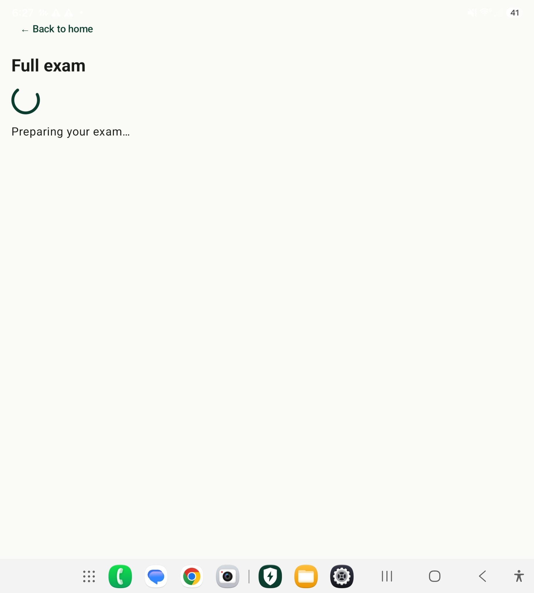
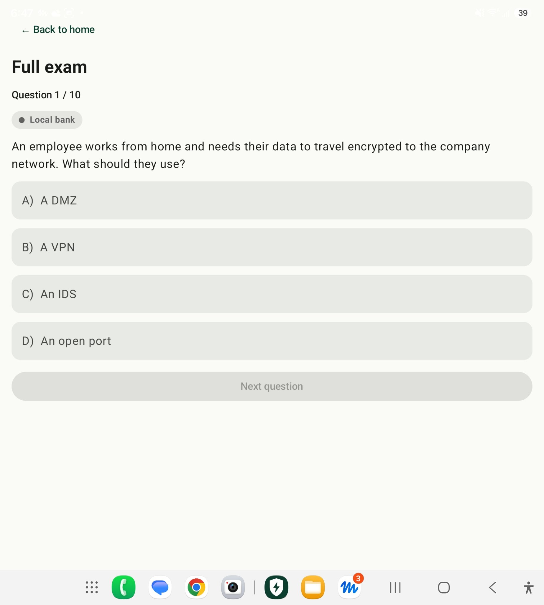
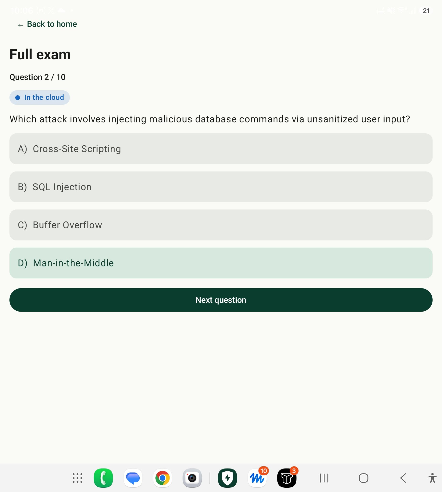
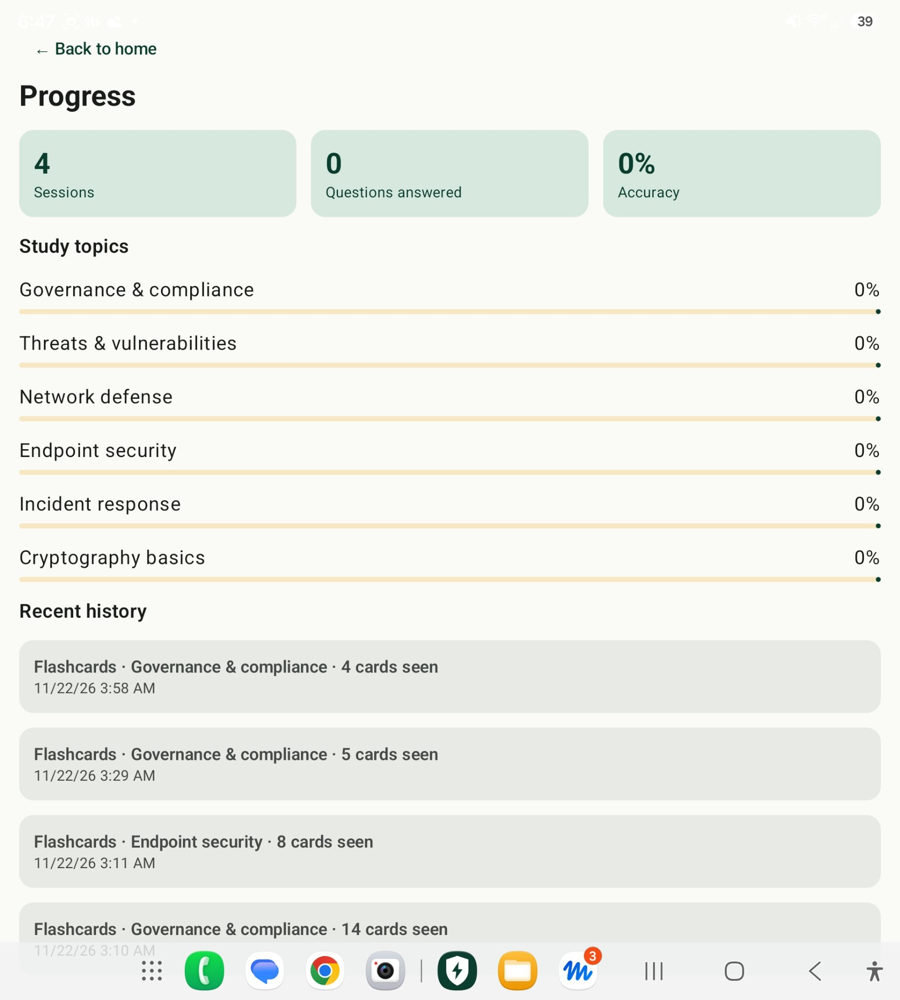

# CyberDrill — Cybersecurity drills with hybrid AI

**CyberDrill** is a pocket study tutor for people preparing for cybersecurity
certifications (built around a real Cisco NetAcad study path). Its core idea:

> **Drill offline. Pass with the cloud.**

Short practice runs on **Gemini Nano, on the device** — in airplane mode, for
free, with nothing leaving the phone. Deep study — a full 10-question exam
with explanations and a progress analysis in Spanish — runs on **Gemini in
the cloud**. One SDK, **Firebase AI Logic**, routes every call, and the app
**shows a badge on every answer** telling you where it was actually generated:
*On device* or *In the cloud*.

Built for the **#BuildHybridAI 2026** hackathon (Firebase AI Logic, hybrid
inference). Android app, Kotlin + Jetpack Compose. The UI is bilingual with
**Spanish as the default language** and a visible ES/EN selector whose choice
persists — because the people this app is for study in Spanish, while most
certification material only exists in English.

---

## Screenshots

Real captures from the test device (Samsung Galaxy Z Fold7):

| Full exam being prepared in the cloud | Full exam, question 1 | Full exam, question 2 | Progress |
|---|---|---|---|
|  |  |  |  |

## What the app does

- **Home** — the six study topics (Governance & compliance, Threats &
  vulnerabilities, Network defense, Endpoint security, Incident response,
  Cryptography basics) with a per-topic mastery bar, plus the live status of
  the hybrid AI (seed mode / on-device model state).
- **Flashcards** — terms per topic. The definition starts from the built-in
  bank; one tap asks the hybrid model for a fresh definition and badges the
  real inference source.
- **Mini-quiz** — 5 quick questions per topic, playable fully offline, with an
  optional **new AI-generated question** per round (hybrid route). Every tap
  guarantees a visibly different question: the prompt excludes the current
  question and rotates its focus, and the cloud route uses temperature so
  repeats don't happen.
- **Full exam** — 10 questions with explanations and a closing progress
  analysis, generated by the cloud model in two parallel blocks of five with
  real on-screen progress ("5 of 10 questions ready"); per-topic results feed
  mastery.
- **Progress** — sessions, answered questions, accuracy, per-topic mastery
  and history. Stored **locally only** (DataStore); there are no accounts.

## The hybrid design — what runs where, and why

Firebase AI Logic's hybrid SDK (`firebase-ai` + `firebase-ai-ondevice`)
exposes one `GenerativeModel`. CyberDrill builds three:

| Model | Config | Used for | Why there |
|---|---|---|---|
| Hybrid | cloud model `Gemini Flash` + `OnDeviceConfig(InferenceMode.PREFER_ON_DEVICE, maxOutputTokens = 256)` | Flashcard definitions, single mini-quiz questions | Short, structured, single-turn tasks — exactly the envelope Google validates for Gemini Nano. They work offline, instantly, privately, at zero cost; if Nano is unavailable the same call falls back to the cloud automatically. |
| Cloud, creative | `Gemini Flash`, `temperature = 0.9` | Fresh single questions from the cloud route | Variety is the point: a study app that repeats the same generated question teaches nothing. |
| Cloud, exam | `Gemini Flash`, strict JSON mode (`responseMimeType = "application/json"`), `maxOutputTokens = 2048`, minimal thinking | Full exam generation, progress analysis | Long, rich generation **in Spanish**. On-device inference is single-turn, short-output, and Google only validates English/Korean on-device — so rich Spanish belongs in the cloud by design, not by accident. The exam is generated as two parallel 5-question blocks with a per-block retry, so one bad block never restarts the whole exam. |

Every response's `response.inferenceSource` (`ON_DEVICE` / `IN_CLOUD`) is
read and displayed as a badge in the UI. On-device model lifecycle is managed
explicitly at startup (`checkStatus()` → `download()` if downloadable →
`warmUp()`), because the SDK never downloads the model implicitly.

**App Check** is installed in `CyberDrillApplication`: the **debug provider**
in debug builds (register the debug token printed to Logcat under
*Firebase console → App Check → Manage debug tokens*), **Play Integrity** in
release builds.

### Seed mode (offline fallback)

The app carries a built-in **seed bank** of 42 flashcards and 24 quiz
questions (original content, ES + EN). If Firebase is not configured (for
example, a build made with a placeholder `app/google-services.json` — the
client detects the `PLACEHOLDER` API key at startup) the app runs entirely
from that bank and answers are badged *Local bank*. The same bank is the
runtime fallback whenever an AI call fails (offline, AICore busy, quota),
so nothing in the app dead-ends — with or without a network.

## Firebase connection

The app is connected to the Firebase project **`cyberdrill-1b630`**:

1. ✅ Android app registered with package **`com.cyberdrill.app`**.
2. ✅ **AI Logic** enabled with the **Gemini Developer API** backend (free
   tier, no billing).
3. ✅ Real **`google-services.json`** in place at `app/google-services.json`
   (standard Android client configuration, restricted by package name and
   signing certificate).
4. ✅ **App Check debug token** from the test device registered in the
   console; on-device inference verified on real hardware — a mini-quiz
   question answered with the **On device** badge on a Galaxy Z Fold7, and
   full exams answered with the **In the cloud** badge.
5. On a Gemini Nano–capable phone (Pixel 9/10/11, recent Galaxy flagships…)
   short tasks start answering **on device** — try airplane mode. Gemini
   Nano does **not** run on emulators; there the hybrid model transparently
   answers from the cloud.

## Build

Requirements: JDK 17, Android SDK with platform 35 and build-tools 34+.

```bash
# Gradle (wrapper pinned to Gradle 8.9; AGP 8.5.2, Kotlin 2.0.20)
./gradlew assembleDebug
# APK: app/build/outputs/apk/debug/app-debug.apk
```

### Building in a sandbox without a Gradle daemon

The development sandbox used for this project blocks raw localhost TCP,
which the Gradle daemon protocol needs, so `assembleDebug` cannot run
*inside that VM*. As a verified stand-in, `manual-build/` contains a manual
pipeline (aapt2 + kotlinc + d8, no daemon):

```bash
python3 manual-build/resolve_deps.py   # downloads the pinned dependency graph to app/libs/
./manual-build/build-manual.sh         # produces manual-build/out/app-debug.apk
```

It resolves the exact versions declared in `app/build.gradle.kts`, merges
the library manifests (`manual-build/merge_manifests.py`), generates the
Firebase config resources from `app/google-services.json`
(`manual-build/gen_firebase_res.py`), and signs a debug APK. (The pipeline's
tool jars under `manual-build/tools/` are local downloads and are not
committed.) On any normal machine, prefer the Gradle build above.

## Project layout

```
app/src/main/java/com/cyberdrill/app/
  CyberDrillApplication.kt   App Check install + AI client init
  MainActivity.kt            Compose entry point
  ai/HybridAiClient.kt       The Firebase AI Logic wrapper (hybrid + cloud models)
  ai/StudyAi.kt              Prompts + strict parsers + local analysis fallback
  data/Topics.kt             The six study topics
  data/SeedBank.kt           42 flashcards + 24 questions (ES/EN), seed fallback
  data/ProgressStore.kt      DataStore: language + session history
  ui/…                       Theme, navigation, screens, inference-source badge
manual-build/                Daemon-free verification pipeline (see above)
screenshots/                 Real captures from the test device
```

## License

MIT — see [LICENSE](LICENSE).
